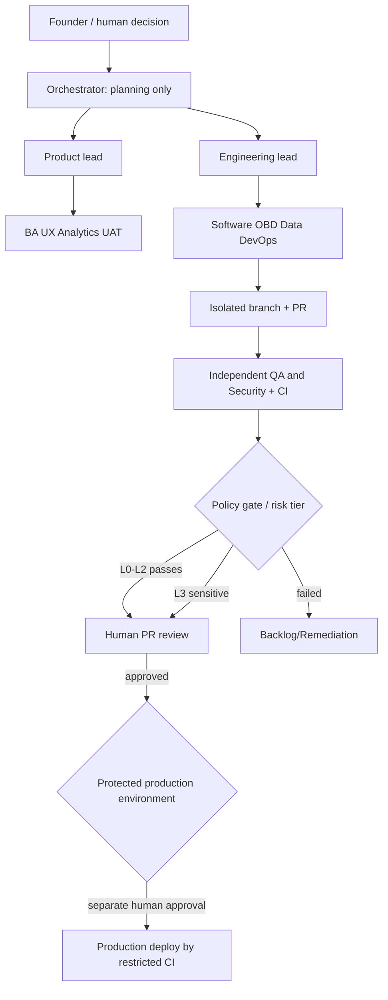

# MFK AI-First Operating Architecture

## Components
- **Control plane:** external orchestrator, policy engine, immutable-ish audit store, task queue, agent-run metadata.
- **Execution plane:** ephemeral sandbox runners per issue/branch; no production credentials.
- **Evidence plane:** PR comments/artifacts for test reports, threat review, plan, diff, rollback.
- **Delivery plane:** GitHub branch rulesets; protected deployments and managed secrets. No AI direct production access.

## Proposed role IDs
Canonical list: `agents/registry.json`. IDs: `orchestrator`, `product-lead`, `product-manager`, `business-analyst`, `ux-reviewer`, `product-analytics`, `uat`, `engineering-lead`, `software-engineer`, `obd-iot`, `devops`, `qa-automation`, `data-recommendations`, `cybersecurity`.

`registry.json` `operational` is **false**. Markdown plus CI file checks are not an orchestrator.

## Data lifecycle
Use `dev` synthetic DB, `staging` masked fixtures / separate auth keys, `production` customer data only. Keep per-environment migration histories and documented restoration procedures. `production` release must use approved CI job and scoped credentials.

## Definition of done
Requirements + acceptance criteria; isolated diff; tests; independent security check; no secrets; appropriate approval; release/rollback plan. Do not claim tested without actual run output.
