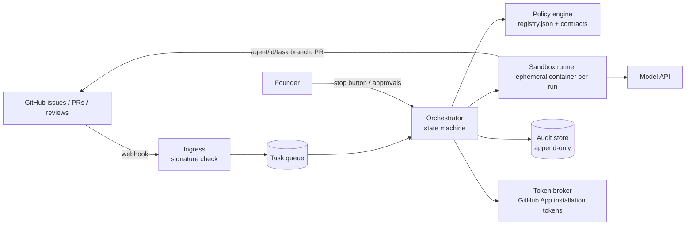

# AI orchestration service: implementation plan

Status: **plan only**. Nothing here is built or deployed. `agents/registry.json` stays `operational: false` until the exit criteria at the end are met and a human flips it in a reviewed PR.

## Goals and non-goals

Goals:
- Run the roles in `agents/registry.json` on GitHub issues, one task at a time, producing PRs with evidence.
- Make every permission a property of a credential or a check, not of a prompt.
- Keep humans in every L3/L4 seat and make approvals verifiable.

Non-goals:
- No production database, Supabase service-role key, Stripe/payment key, EAS production token, or Vercel production token anywhere in the service.
- No live-vehicle access. No Bluetooth hardware attached to any runner.
- No auto-merge, no deploy step.

## Components

| Component | Responsibility | Notes |
|---|---|---|
| Ingress | Receives GitHub App webhooks, verifies `X-Hub-Signature-256`, drops anything else | Only event types: `issues`, `issue_comment`, `pull_request`, `pull_request_review`, `check_run` |
| Task queue | One message per task transition; dead-letter after N retries | Idempotency key = `taskId` + `transitionId` |
| Orchestrator | Applies `agents/contracts/task-status.json`; picks the next agent from `handoff.nextAgentIds`; rejects illegal transitions | Deterministic code, **not** an LLM. The `orchestrator` role prompt only drafts task graphs for humans |
| Policy engine | Loads `agents/registry.json` and the contracts from `main` at a pinned SHA; validates every handoff report; computes required approvals from `sensitiveOperations` | Same glob logic as `.github/scripts/agent-path-guard.mjs` (share the module) |
| Token broker | Mints GitHub App installation tokens per run, scoped by `maxLevel` | L0: `contents: read`. L1–L2: `contents: write` + `pull_requests: write`, restricted to the one repository. Never `workflows`, `administration`, `secrets`, `environments`. TTL ≤ 1 h, revoked at run end |
| Sandbox runner | Ephemeral container per run: clone, `pnpm install --frozen-lockfile` (respects `minimumReleaseAge`), run the agent, push `agent/<id>/<taskId>`, open PR | Egress allow-list: GitHub, npm registry, model API. No Supabase/Vercel/Expo/Stripe hosts. No host networking, no device passthrough |
| Audit store | Append-only log of every transition, prompt hash, tool call, token scope, report, cost | Separate database from the product. Never the production Supabase project |
| Approval verifier | Builds `approval-record` from reviews/comments via the GitHub API; checks account type `User`, not PR author, `approve:<op>` token, head SHA | A new push voids approvals |
| Stop button | Founder-only endpoint and `/mfk stop` comment that pauses the queue and revokes live tokens | Default on start-up: paused |

## Runtime flow

1. Human files an issue with the `MFK Task` form → `draft`.
2. Human triages → `ready` (risk tier, sensitive operations, approver set).
3. Orchestrator assigns `software-engineer` (or `obd-iot`, `data-recommendations`) → `in_progress`, mints a token, starts a sandbox.
4. Agent pushes `agent/<id>/<taskId>`, opens a PR, returns a handoff report. Policy engine validates it against `handoff-report.schema.json`; invalid → `escalated`.
5. CI runs, including `Agent path guard` and the config validator. Mobile typecheck runs when its paths change.
6. `qa-automation` (different run, different agentId) → `qa_verified`; `cybersecurity` → `security_reviewed`.
7. Orchestrator checks all evidence → `awaiting_human_approval` and comments the required `approve:<op>` tokens.
8. Human reviews and approves. Approval verifier records it → `approved`. Human merges → `done`.
9. Release is a separate L4 task through the GitHub `production` environment. The service has no part in it.

## Technology choice (proposed)

- TypeScript service in a **separate repository** (or a separate workspace package that is not deployed with the product). Keeping it out of `artifacts/` stops it from inheriting the product's Replit/Vercel deploy config and secrets.
- Agent runtime: Claude Agent SDK (or an equivalent) running inside the sandbox, with the tool allow-list derived from `maxLevel`. L0 runs get no shell and no write tools.
- Queue + audit: a dedicated Postgres instance (not the product database) or a managed queue. Audit table insert-only via database grants.
- Sandbox: ephemeral containers (GitHub Actions on a dedicated self-hosted runner group, or a container service) with network policy enforced outside the container.

## Security controls mapped to threats

| Threat | Control |
|---|---|
| Prompt injection in issues, PR comments, logs, vehicle data | Untrusted text passed as data; agent output must validate against schema; `promptInjectionFlags`; no tool that can raise its own privileges |
| Agent edits its own permissions | `agents/**`, `policies/**`, `.github/**` are protected paths; guard loaded from base commit; app lacks Workflows permission |
| Agent touches auth, payment, binding, DB | `protectedPaths` → path guard fails; L3 human approval required; a human must make the change |
| Secret exfiltration through PR workflows | No Workflows permission; validator rejects `pull_request_target` and secrets in `ai-*` workflows; sandbox egress allow-list |
| Supply-chain attack via new dependency | `package.json`/lockfile/`pnpm-workspace.yaml` protected; `minimumReleaseAge` enforced by validator |
| Fake approval | Approval verifier checks account type, author, SHA, operation token; only humans reach `approved`/`done` |
| Runaway cost or loops | Per-task token/time/cost caps; max transitions per task; dead-letter queue; stop button |
| Live vehicle harm | No hardware in sandbox; `obdCommandPolicy` deny list checked in fixture tests; L3 + default deny |

## Delivery phases

Each phase is its own PR series with human approval. No phase starts until the previous exit criteria are met.

| Phase | Build | Exit criteria |
|---|---|---|
| A. Controls | Human applies `docs/github-controls.md` (branch protection, ruleset, required checks, app without Workflows permission) | Test PR from a throw-away `agent/devops/T-0` branch touching `.github/` is blocked by the path guard and by GitHub |
| B. Read-only | Ingress + orchestrator + audit store; L0 roles only (`product-manager`, `engineering-lead`, `cybersecurity` reports as issue comments) | 10 historic issues replayed; every report validates; no write token ever minted (audit proves it) |
| C. Sandbox writes | Token broker, sandbox runner, `software-engineer` + `qa-automation` on non-protected paths | 10 PRs opened; 0 path-guard bypasses; 0 auto-merges; every test claim has a log |
| D. Specialists | `obd-iot` and `data-recommendations` on simulators/fixtures | PID matrix and recommendation fixtures green; deny-list tests for mode 04/08 and UDS write services |
| E. Governed automation | Cost caps, retries, stop button drill, canary metrics | Stop drill revokes all tokens within 60 s; monthly cost under cap; founder signs off on `operational: true` PR |

## Open decisions for a human

1. Where the service runs (separate repo + cloud project recommended) and who pays for it.
2. Which model provider and data-retention settings are acceptable for source code.
3. Who the second human is for `production-environment-reviewer`.
4. Whether `mfk-web` should be in `software-engineer` writable scope (included now; remove if web is frozen).
